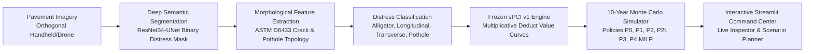

# Road PCI Intelligence

[](https://github.com/skilloutofbounds/road-pci-intelligence/actions/workflows/ci.yml)
[-blue.svg)](file:///c:/Users/Ved/Desktop/DLbasedRoadCracks/road-pci-intelligence/configs/spci_params.yaml)
[](LICENSE)
[](requirements-app.txt)

An end-to-end cyber-physical deep learning and decision-support system designed to automate pavement distress detection, calculate objective condition indices, and optimize municipal infrastructure maintenance. Manual road pavement inspection is dangerous, subjective, and costly to scale across large municipal networks. By leveraging deep semantic segmentation to detect distress patterns from orthogonal roadway imagery, extracting physical ASTM D6433 distress categories, computing an objective, simplified Pavement Condition Index (**sPCI v1**), and running 10-year budget-constrained Monte Carlo simulations, this system bridges the gap between computer vision perception and municipal capital allocation.

---

## 1. System Overview & Architecture



The system operates across four tightly integrated layers:
1. **Perception**: A deep semantic segmentation model (`segmentation_models_pytorch.Unet` with an ImageNet-pretrained `resnet34` backbone) predicts pixel-level road distress masks from RGB pavement imagery.
2. **Morphological Feature Extraction**: Connected-component analysis, skeletonization, spur pruning, width measurement, and junction graph analysis (`src/pavement_features.py`) extract physical geometric distress metrics and classify defects into four standard ASTM D6433 distress categories:
   - **Alligator Cracking**: High junction density and enclosed polygonal cell networks.
   - **Longitudinal Cracking**: Predominantly vertical linear distress paths.
   - **Transverse Cracking**: Predominantly horizontal linear distress paths.
   - **Potholes**: Clustered compact depressions satisfying area and circularity thresholds.
3. **Simplified Pavement Condition Index (`sPCI v1`)**: An objective 0–100 pavement index permanently frozen under Git tag **`spci-v1-frozen`** (`68a30aa`). Uses calibrated deduct-value curves and multiplicative aggregation, categorizing pavement into ASTM D6433 condition bands (Good, Satisfactory, Fair, Poor, Very Poor, Serious, Failed).
4. **Municipal Maintenance Optimization**: A 10-year Monte Carlo asset lifecycle simulation (`src/simulation/engine.py`) modeling 200 synthetic roadway segments under fiscal capital constraints across six maintenance policies (P0–P4, P2t) using greedy heuristics and exact 0/1 Integer Linear Programming (HiGHS solver).

---

## 2. Verified Ground-Truth Metrics Summary

All metrics are directly traceable to `docs/PROJECT_FACTS.md` and repository artifacts.

### 2.1 Ingestion Manifest & Split Breakdown

Dataset partitioning enforces group-aware, leak-proof splitting (no shared physical scene stems or augmented variants across splits):

| Dataset Source | License / Terms | Split Count (Train / Val / Test) | Pixel-Weighted FG (%) | Mean Per-Image FG (%) |
| :--- | :--- | :---: | :---: | :---: |
| **`crack500`** | Academic / Research Use | 329 / 70 / 72 (471 total) | **2.65%** | **2.73%** |
| **`road_crack`** | CC0 Public Domain / CC BY 4.0 | 290 / 77 / 68 (435 total) | **1.75%** *(Value 1 only)* | **1.75%** |
| **`pothole`** | CC0 Public Domain / CC BY 4.0 | 612 / 108 / 60 (780 total) | **15.98%** | **15.98%** |
| **Combined Segmentation Dataset** | **Multi-Benchmark** | **1,231 / 255 / 200 (1,686 total)** | — | — |
| **`rdd2022es`** | Kaggle metadata: `CC-BY-NC-SA-4.0`<br>Description: `CC BY-SA 4.0` | 20,480 / 2,560 / 2,560 (25,600 total)<br>*(4 countries: USA, India, Japan, Czech Republic; 8 classes)* | — | — |

*Note on road-crack raw mask value distribution*: Value 1 (Crack) = **1.75%** (3,126,349 px); Value 2 (Construction Joints) = **2.03%** (3,617,725 px); Value 3 (Core Drilling) = **0.02%** (38,614 px); Value 0 (Background) = **96.19%**. Values 2 & 3 are mapped to background to prevent penalizing intentional slab joints and core cuts.

### 2.2 Frozen sPCI v1 Parameters (`configs/spci_params.yaml`)

- **Git Ref**: Tag `spci-v1-frozen` (commit `68a30aa532f9c7ae9eb36890915d957656eaa8d7`)
- **Distress Weights ($w_k$)**: Alligator `0.35`, Pothole `0.30`, Transverse `0.20`, Longitudinal `0.15` ($\sum w_k = 1.00$).
- **Log Density Scale ($\beta$)**: `5.0`
- **Severity Exponents**: Low $s_{\text{low}} = 0.5$, Medium $s_{\text{med}} = 1.0$, High $s_{\text{high}} = 1.5$.
- **Empirical Severity Thresholds**:
  - Crack severity: Low $\le 4.394\text{ px}$, High $> 11.588\text{ px}$
  - Network factor: $n_{\text{ref}} = 1.275$, $\beta = 0.5$
  - Noise floor: $\tau = 0.00$
- **Corrected Deduct Value (CDV)**: $\text{CDV} = 100 \cdot (1 - \prod (1 - \text{DV}_i / 100))$, $\text{sPCI} = 100 - \text{CDV}$.

### 2.3 Double-Blind Human Validation Alignment (`results/rdd_validation_features.csv`)

Evaluated against blinded human pairwise ratings across the held-out test split ($N = 47$ valid pairs, 13 pairs labeled "same" excluded):

| Subset / Source | Evaluated Pairs ($N$) | Ties ($|\Delta\text{sPCI}| < 1.0$) | Agreement Points | Agreement Rate (%) | 95% Bootstrap CI |
| :--- | :---: | :---: | :---: | :---: | :---: |
| **Overall (All Distress Types)** | **47** | **2** | **36.0** | **76.60%** | **[64.89%, 87.23%]** |
| `crack500` | 17 | 0 | 15.0 | **88.24%** | [70.59%, 100.00%] |
| `road_crack` | 16 | 0 | 15.0 | **93.75%** | [81.25%, 100.00%] |
| **Combined Cracks** (`crack500` + `road_crack`) | 33 | 0 | 30.0 | **90.91%** | [78.79%, 100.00%] |
| `pothole` | 14 | 2 | 6.0 | **42.86%** | [17.86%, 67.86%] |
| **Damage Area Baseline** | 47 | — | 35.0 | **74.47%** | [61.70%, 85.11%] |

*Primary Statistical Finding*: The paired difference between sPCI and the naive damage area baseline is $+2.13\%$ with a 95% bootstrap confidence interval of $[-2.13\%, +7.45\%]$. Because the interval strictly spans 0, there is **no detectable difference** between sPCI and the damage area baseline on the overall set. Strong alignment is achieved on crack distress (90.91%), while pothole agreement (42.86%) cannot be distinguished from random guessing.

### 2.4 Base Scenario 10-Year Lifecycle Simulation (`docs/simulation.md`)

Simulated across 200 synthetic roadway segments over a 10-year cycle (200 Monte Carlo runs, 10% budget):

#### Pool 'all' ($668,193\text{ m}^2$, 10-Year Budget $B_{10} = \$3,340,965$)

| Policy | Strategy Description | Area-Weighted Condition (AW CY) | Traffic-Weighted Condition (TW CY) | 10-Year Spend ($) | Budget Spent (%) | TW Efficiency (CY/$) |
| :--- | :--- | :---: | :---: | :---: | :---: | :---: |
| **P0** | Do Nothing | 361.64 | 357.01 | $0 | 0.00% | 0.000 |
| **P1** | Reactive ($\text{PCI} < 40$) | 642.80 | 644.01 | $3,068,687 | 91.85% | 0.0935 |
| **P2** | Worst-First (ASTM bands) | **660.50** | 661.66 | $3,337,775 | 99.90% | 0.0913 |
| **P2t** | Traffic-Aware Worst-First | 626.94 | 672.45 | $3,336,948 | 99.88% | 0.0945 |
| **P3** | Greedy Benefit/Cost | 655.82 | 730.69 | $3,337,095 | 99.88% | **0.1120** |
| **P4** | Integer Linear Program (HiGHS) | 656.77 | **731.54** | $3,339,967 | 99.97% | **0.1120** |

#### Pool 'cracks' ($702,355\text{ m}^2$, 10-Year Budget $B_{10} = \$3,511,774$)

| Policy | Strategy Description | Area-Weighted Condition (AW CY) | Traffic-Weighted Condition (TW CY) | 10-Year Spend ($) | Budget Spent (%) | TW Efficiency (CY/$) |
| :--- | :--- | :---: | :---: | :---: | :---: | :---: |
| **P0** | Do Nothing | 545.69 | 548.51 | $0 | 0.00% | 0.000 |
| **P1** | Reactive ($\text{PCI} < 40$) | 603.31 | 605.78 | $1,629,136 | **46.39%** | 0.0890 |
| **P2** | Worst-First (ASTM bands) | 774.12 | 775.69 | $1,738,154 | 49.50% | 0.0901 |
| **P2t** | Traffic-Aware Worst-First | 774.15 | 775.95 | $1,738,154 | 49.50% | 0.0901 |
| **P3** | Greedy Benefit/Cost | 813.03 | 844.97 | $3,506,000 | 99.84% | **0.1118** |
| **P4** | Integer Linear Program (HiGHS) | **812.24** | **844.53** | $3,509,000 | 99.92% | **0.1118** |

*Key Simulation Mechanics*:
- **P1 Budget Under-Spending**: On the cracks pool, P1 spends only $\$1,629,136$, which is **46.39%** of the $\$3,511,774$ pool budget (or **48.76%** of the baseline $\$3,340,965$ reference budget). Because P1 ignores roads with $\text{PCI} \ge 40$, it exhausts eligible candidates and cannot spend available funds.
- **P2 and P2t Coincidence**: When the budget does not bind (only 49.50% spent), ordering candidate segments by worst-first vs traffic-urgency selects the exact same segments, producing identical AW condition ($774.99\text{ CY}$) and near-zero TW delta ($+0.23$).
- **Bias vs Noise Domination**: On the cracks pool, tile-level bias ($b = -5.0$) causes $\approx +109\text{ AW CY}$ regret, dominating zero-mean noise ($\lambda \in [0.5, 1.0]$, $+10$ to $+23\text{ AW CY}$ regret) by $5\times$ to $10\times$.

---

## 3. Interactive Streamlit Command Center Guide

The web application (`app.py`) provides an interactive interface for pavement inspection, empirical validation, and municipal policy simulation:

```bash
# Launch the application locally
streamlit run app.py
```

### Tab Navigation
- **Tab 1: Live Pavement Inspector**:
  - Run deep inference on 4 verified held-out test split sample images or custom user uploads.
  - Generates qualitative distress overlays, extracts ASTM D6433 morphological statistics, computes sPCI, and displays condition rating badges.
  - **In-Memory Privacy Guarantee**: Images are processed strictly in memory and are never saved to disk.
  - **Latency**: CPU inference takes ~8 s locally, 15–25 s on free cloud tiers.
- **Tab 2: Double-Blind Human Alignment**:
  - Interactively explores the 47 test pair evaluations from `results/rdd_validation_features.csv`.
  - Displays runtime agreement (76.60%), confusion matrices, score distributions, and bootstrap confidence intervals.
- **Tab 3: 10-Year Municipal Simulator**:
  - Interactive scenario planner for municipal capital allocation.
  - Customize budget limits ($0–20\%$), network scale ($50–300$ segments), traffic weighting, and run comparative policy analyses (P0–P4, P2t).

### Unified Image Preprocessing Rule
Every input image (held-out test samples and user uploads) is processed under a single unified rule:
1. EXIF orientation corrected; converted to RGB.
2. If $\min(H, W) > 720$, downscale preserving aspect ratio such that $\min(H, W) = 720$, with the long side capped at $1280$.
3. Otherwise, retain native resolution (never upscale). Minimum allowable dimension is $256 \times 256$.

---

## 4. Reproducibility & Automated Test Suite

Run the comprehensive unit test suite locally:

```bash
# 1. Project facts and documentation integrity (weights SHA-256, tag commit 68a30aa, 76.60% agreement)
python -m unittest -v tests/test_facts.py

# 2. End-to-end perception pipeline fidelity (reproduces stored sPCI within 0.5 points)
python -m unittest -v tests/test_pipeline.py

# 3. 10-year municipal maintenance simulation (14 tests: budget enforcement, monotonicity, P4 optimality)
python -m unittest -v tests/test_simulation.py

# 4. Streamlit UI smoke test (AppTest: 0 exceptions, 3 tabs rendered, 76.60% agreement verified)
python -m unittest -v tests/test_app_ui.py

# Run all tests across the repository:
python -m unittest discover -v tests
```

---

## 5. Scientific Boundaries & Disclaimers

1. **Stylized Maintenance Unit Costs**: Maintenance costs ($1, 3, 5, 8, 12$) and network budgets ($\$0.50/\text{m}^2/\text{year}$) are stylized relative benchmarks for algorithmic comparison. No claims of real-world municipal tax savings or infrastructure life-cycle guarantees are asserted.
2. **Heuristic Oracle Regret**: Regret relative to the heuristic oracle can occasionally be negative because fixed threshold rules are not globally tuned to the 10-year dynamic simulation horizon.
3. **Threshold Mechanics as Hypotheses**: Behavioral explanations regarding policy threshold dynamics (e.g., `[Hypothesis]` bumps segments above preventive threshold, `[Hypothesis]` forces P1 to treat borderline segments) are designated as hypotheses.
4. **Close-Up Downward Perspectives**: The perception model is trained exclusively on orthogonal, close-up roadway imagery (handheld smartphone or drone capture). It is **not** trained for vehicle dashcam or street-level perspective imagery.
