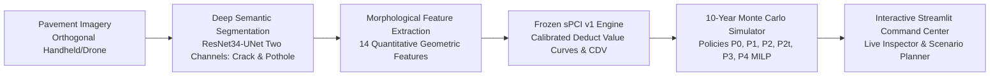

# Road PCI Intelligence

[](https://github.com/skilloutofbounds/road-pci-intelligence/actions/workflows/ci.yml)
[-blue.svg)](configs/spci_params.yaml)
[](LICENSE)
[](requirements-app.txt)

An end-to-end cyber-physical deep learning and decision-support system designed to automate pavement distress detection, compute objective condition indices, and simulate municipal capital allocation. Manual road pavement inspection is dangerous, subjective, and costly to scale across large municipal networks. By leveraging deep semantic segmentation to detect distress patterns from orthogonal roadway imagery, extracting physical morphological distress metrics, computing an objective, simplified Pavement Condition Index (**sPCI v1**), and running 10-year budget-constrained Monte Carlo simulations, this system bridges the gap between computer vision perception and municipal capital allocation.

---

## 1. System Overview & Architecture



The system operates across four tightly integrated layers:
1. **Perception**: A deep semantic segmentation model (`segmentation_models_pytorch.Unet` with an ImageNet-pretrained `resnet34` backbone) outputs TWO independent channels: crack and pothole [claim_model_heads]. Crack types are NOT classified into individual subcategories; all detected cracks are evaluated via unified continuous topological metrics [claim_crack_types_not_classified].
2. **Morphological Feature Extraction**: Connected-component analysis, distance transforms, skeletonization, spur pruning, and junction graph analysis (`src/pavement_features.py`) extract exactly 14 quantitative morphological and topological features from the segmented distress masks:
   - `crack_area_frac`: Dimensionless surface fraction of pavement covered by cracks [claim_14_features_crack_area].
   - `crack_length_px`: Pruned skeleton centerline length in normalized pixels [claim_14_features_crack_length_px].
   - `crack_length_short_sides`: Normalized crack linear extent expressed in units of 512 px image short sides [claim_14_features_crack_length_short_sides].
   - `mean_width_px`: Mean physical crack width in normalized pixels [claim_14_features_mean_width_px].
   - `relative_width`: Dimensionless scale-invariant relative crack width normalized to image scale [claim_14_features_relative_width].
   - `max_width_px`: Maximum local crack diameter from Euclidean distance transform [claim_14_features_max_width_px].
   - `width_p90_px`: 90th percentile local crack width along the skeleton [claim_14_features_width_p90_px].
   - `n_crack_components`: Number of distinct, isolated 8-connected crack components [claim_14_features_n_crack_components].
   - `n_junctions`: Number of branching nodes on the pruned skeleton after spur stripping [claim_14_features_n_junctions].
   - `cells`: Number of enclosed background regions inside closed crack loops [claim_14_features_cells].
   - `network_index`: Topological meshing density measured as junctions plus cells per 100 px [claim_14_features_network_index].
   - `pothole_count`: Number of distinct 8-connected pothole defects [claim_14_features_pothole_count].
   - `pothole_area_frac`: Dimensionless surface fraction of pavement occupied by potholes [claim_14_features_pothole_area_frac].
   - `largest_pothole_frac`: Surface fraction of the single most severe pothole defect [claim_14_features_largest_pothole_frac].
3. **Simplified Pavement Condition Index (`sPCI v1`)**: An objective 0–100 index permanently frozen under Git tag **`spci-v1-frozen`** (`68a30aa`) [claim_spci_params_frozen_tag]. Distress deduct values follow power-law deduct curves DV = min(100.0, a * q^b) [claim_spci_deduct_curve_power], aggregated via Corrected Deduct Value (CDV) combination sPCI = 100.0 - CDV [claim_spci_cdv_formula] using calibrated parameters from `configs/spci_params.yaml`.
4. **Municipal Maintenance Optimization**: A 10-year Monte Carlo asset lifecycle simulation (`src/simulation/engine.py`) modeling 200 synthetic roadway segments under capital constraints across six maintenance policies (P0–P4, P2t) using greedy heuristics and exact 0/1 Integer Linear Programming (HiGHS solver).

---

## 2. Traceable Ground-Truth Evidence & Benchmarks

All quantitative claims are traceable to `docs/claims.csv` and repository source files.

### 2.1 Ingestion Manifest & Split Breakdown

Dataset partitioning enforces group-aware, leak-proof splitting (no shared physical scene stems or augmented variants across splits):

| Dataset Source | Split Count (Train / Val / Test) | Pixel-Weighted FG (%) | Mean Per-Image FG (%) | Traceable Claim |
| :--- | :---: | :---: | :---: | :--- |
| **`crack500`** | 329 / 70 / 72 (471 total) | 2.65% | 2.73% | [claim_split_crack500], [claim_fg_crack500] |
| **`road_crack`** | 290 / 77 / 68 (435 total) | 1.75% *(Value 1 crack only)* | 1.75% | [claim_split_road_crack], [claim_fg_road_crack] |
| **`pothole`** | 612 / 108 / 60 (780 total) | 15.98% | 15.98% | [claim_split_pothole], [claim_fg_pothole] |
| **Combined Segmentation Dataset** | **1,231 / 255 / 200 (1,686 total)** | — | — | [claim_split_combined] |
| **`rdd2022es`** | 20,480 / 2,560 / 2,560 (25,600 total)<br>*(4 countries: USA, India, Japan, Czech Republic; 8 classes)* | — | — | [claim_split_rdd2022es] |

*Multi-class road-crack raw mask value distribution* [claim_road_crack_raw_values]: Value 1 (Crack) = 1.75% (3,126,349 px); Value 2 (Construction Joints) = 2.03% (3,617,725 px); Value 3 (Core Drilling) = 0.02% (38,614 px); Value 0 (Background) = 96.19% (171,393,312 px). Values 2 and 3 are mapped to background to prevent penalizing intentional slab joints and core cuts.

### 2.2 Frozen sPCI v1 Specification (`configs/spci_params.yaml`)

- **Git Ref**: Tag `spci-v1-frozen` (commit `68a30aa532f9c7ae9eb36890915d957656eaa8d7`) [claim_spci_params_frozen_tag].
- **Deduct Formulation**: Deduct values are modeled as power-law functions DV = min(100.0, a * q^b) [claim_spci_deduct_curve_power].
- **Combination Method**: Corrected Deduct Value CDV = 100.0 * (1.0 - product(1.0 - DV_i / 100.0)), sPCI = 100.0 - CDV [claim_spci_cdv_formula].
- **Empirical Severity Thresholds**:
  - Crack severity: Low <= 4.394 px, High > 11.588 px
  - Network factor: n_ref = 1.275, beta = 0.5
  - Noise floor: tau = 0.00 normalized short sides

### 2.3 Double-Blind Human Validation Alignment

Evaluated against blinded human pairwise deterioration judgments on the test split (60 total pairs: 27 A, 20 B, 13 same [claim_human_pairs_distribution]; 13 same pairs excluded yielding N = 47 evaluated pairs [claim_human_agreement_overall]):

| Subset / Source | Evaluated Pairs (N) | Ties (|Delta sPCI| < 1.0) | Agreement Points | Agreement Rate (%) | 95% Bootstrap CI | Traceable Claim |
| :--- | :---: | :---: | :---: | :---: | :---: | :--- |
| **Overall (All Distress Types)** | **47** | **2** | **36.0** | **76.60%** | **[64.89%, 87.23%]** | [claim_human_agreement_overall] |
| `crack500` | 17 | 0 | 15.0 | 88.24% | [70.59%, 100.00%] | [claim_human_cracks_agreement] |
| `road_crack` | 16 | 0 | 15.0 | 93.75% | [81.25%, 100.00%] | [claim_human_cracks_agreement] |
| **Combined Cracks** (`crack500` + `road_crack`) | 33 | 0 | 30.0 | 90.91% | [78.79%, 100.00%] | [claim_human_cracks_agreement] |
| `pothole` | 14 | 2 | 6.0 | 42.86% | [17.86%, 67.86%] | [claim_human_pothole_agreement] |

*Statistical Comparison vs Baseline*:
The paired difference between sPCI and the naive damage area baseline is +2.13 percentage points with a 95% bootstrap confidence interval of [-2.13%, +7.45%] [claim_human_area_ci]. Because the confidence interval spans 0, there is **no detectable difference** between sPCI and the damage area baseline overall [claim_human_area_baseline_diff]. While crack distress demonstrates strong alignment (30/33 pairs agreed, 90.91% [claim_human_cracks_agreement]), pothole agreement (6.0/14 pairs agreed, 42.86% [claim_human_pothole_agreement]) cannot be distinguished from random guessing.

### 2.4 Cross-Domain Out-of-Domain Failure Mode Check (RDD2022ES Test Split)

Evaluated across all 2,560 images of the held-out RDD2022ES test split to document domain transfer limitations between close-up roadway photography and vehicle dashcam perspectives:
- **Clean Images without Boxes (N = 800)**: Crack flag > 0.1% occurs on 5.12% (41 / 800) and pothole flag > 0.1% occurs on 45.62% (365 / 800) [claim_rdd_zerobox_clean].
- **Distress Box Hit Rate (>= 5% Box Pixels)**: Pothole channel achieves 19.29% hit rate (54 / 280 images, 432 boxes) [claim_rdd_hit_rate_pothole]. Crack channel achieves 8.48% hit rate (140 / 1,650 images, 3,196 boxes) [claim_rdd_hit_rate_crack].
- **Cross-Channel False Positives**: On images containing ONLY crack bounding boxes (N = 1,480), false pothole activations > 0.1% occur on 34.12% (505 / 1,480) [claim_rdd_cross_channel_fp].

### 2.5 Base Scenario 10-Year Lifecycle Simulation (`docs/simulation.md`)

All maintenance costs, network budgets, and expenditures are illustrative benchmark units, not real accounting currency [claim_sim_illustrative_units].
Because segment geometry is instantiated per pool, the two pools have different total network surface areas (668,192.9 m2 on `all` vs 702,354.8 m2 on `cracks`) and therefore different annual budgets (334,096.5 units/yr on `all` vs 351,177.4 units/yr on `cracks`) [claim_sim_pool_areas_and_budgets].

#### Pool 'all' (668,193 m2, 10-Year Budget B_10 = 3,340,965 units) [claim_sim_pool_all_results]

| Policy | Strategy Description | Area-Weighted Condition (AW CY) | Traffic-Weighted Condition (TW CY) | 10-Year Spend (units) | Budget Spent (%) | TW Efficiency (CY/1k units) |
| :--- | :--- | :---: | :---: | :---: | :---: | :---: |
| **P0** | Do Nothing | 361.64 | 357.01 | 0 | 0.00% | 0.000 |
| **P1** | Reactive (PCI < 40) | 642.80 | 644.01 | 3,068,687 | 91.85% | 0.0935 |
| **P2** | Worst-First (ASTM bands) | 660.50 | 661.66 | 3,337,775 | 99.90% | 0.0913 |
| **P2t** | Traffic-Aware Worst-First | 626.94 | 672.45 | 3,336,948 | 99.88% | 0.0945 |
| **P3** | Greedy Benefit/Cost | 655.82 | 730.69 | 3,337,095 | 99.88% | 0.1120 |
| **P4** | Integer Linear Program (HiGHS) | 656.77 | 731.54 | 3,339,967 | 99.97% | 0.1120 |

#### Pool 'cracks' (702,355 m2, 10-Year Budget B_10 = 3,511,774 units) [claim_sim_pool_cracks_results]

| Policy | Strategy Description | Area-Weighted Condition (AW CY) | Traffic-Weighted Condition (TW CY) | 10-Year Spend (units) | Budget Spent (%) | TW Efficiency (CY/1k units) |
| :--- | :--- | :---: | :---: | :---: | :---: | :---: |
| **P0** | Do Nothing | 545.44 | 548.37 | 0 | 0.00% | 0.000 |
| **P1** | Reactive (PCI < 40) | 618.69 | 620.41 | 1,629,136 | 46.39% | 0.0442 |
| **P2** | Worst-First (ASTM bands) | 774.99 | 776.28 | 1,738,324 | 49.50% | 0.1310 |
| **P2t** | Traffic-Aware Worst-First | 774.99 | 776.51 | 1,738,493 | 49.50% | 0.1310 |
| **P3** | Greedy Benefit/Cost | 810.89 | 845.26 | 3,507,799 | 99.89% | 0.0846 |
| **P4** | Integer Linear Program (HiGHS) | 810.87 | 845.21 | 3,511,596 | 99.99% | 0.0845 |

*Key Simulation Mechanics*:
- **P1 Budget Under-Spending**: On the cracks pool, P1 spends only 1,629,136 units, which is 46.39% of the pool budget [claim_sim_p1_underspending]. Because P1 ignores roads with PCI >= 40, it exhausts eligible candidate segments and cannot spend available funds.
- **P2 and P2t Coincidence**: When the budget does not bind (only 49.50% spent [claim_sim_p2_p2t_coincidence]), ordering candidate segments by worst-first vs traffic-urgency selects the exact same segments, producing identical AW condition (774.99 CY) and near-zero TW delta (+0.23 CY).
- **Bias vs Noise Domination**: On the cracks pool, tile-level bias (b = -5.0) causes +109.06 AW CY regret [claim_sim_bias_dominates_noise], dominating zero-mean noise (lambda in [0.5, 1.0], +10 to +23 AW CY regret) by 5x to 10x.

---

## 3. Interactive Streamlit Command Center Guide

The web application (`app.py`) provides an interactive interface for pavement inspection, empirical validation, and municipal policy simulation:

```bash
# Launch the application locally
streamlit run app.py
```

### Tab Navigation
- **Tab 1: Live Pavement Inspector**:
  - Run deep inference on 4 verified held-out test split sample images or custom user uploads.
  - Generates qualitative distress overlays, extracts 14 morphological statistics, computes sPCI, and displays condition rating badges.
  - **In-Memory Privacy Guarantee**: Images are processed strictly in memory and are never saved to disk.
  - **Latency**: CPU inference takes ~8 s locally, 15–25 s on free cloud tiers.
- **Tab 2: Double-Blind Human Alignment**:
  - Interactively explores the 47 test pair evaluations.
  - Displays runtime agreement (76.60%), confusion matrices, score distributions, and bootstrap confidence intervals.
- **Tab 3: 10-Year Municipal Simulator**:
  - Interactive scenario planner for municipal capital allocation.
  - Customize budget limits (0–20%), network scale (50–300 segments), traffic weighting, and run comparative policy analyses (P0–P4, P2t).

### Unified Image Preprocessing Rule
Every input image (held-out test samples and user uploads) is processed under a single unified rule:
1. EXIF orientation corrected; converted to RGB.
2. If min(H, W) > 720, downscale preserving aspect ratio such that min(H, W) = 720, with the long side capped at 1280.
3. Otherwise, retain native resolution (never upscale). Minimum allowable dimension is 256 x 256.

---

## 4. Reproducibility & Automated Test Suite

Run the comprehensive unit test suite locally:

```bash
# 1. Public claims traceability test (verifies all 45 claims against sources)
python -m unittest -v tests/test_claims.py

# 2. Project facts and documentation integrity (weights SHA-256, tag commit 68a30aa, 76.60% agreement)
python -m unittest -v tests/test_facts.py

# 3. End-to-end perception pipeline fidelity (reproduces stored sPCI within 0.5 points)
python -m unittest -v tests/test_pipeline.py

# 4. 10-year municipal maintenance simulation (14 tests: budget enforcement, monotonicity, P4 optimality)
python -m unittest -v tests/test_simulation.py

# 5. Streamlit UI smoke test (AppTest: 0 exceptions, 3 tabs rendered, 76.60% agreement verified)
python -m unittest -v tests/test_app_ui.py

# Run all tests across the repository:
python -m unittest discover -v tests
```

---

## 5. Scientific Boundaries & Disclaimers

1. **Stylized Maintenance Unit Costs**: Maintenance costs (1, 3, 5, 8, 12 units) and network budgets (0.50 units/m2/year) are stylized relative benchmarks for algorithmic comparison [claim_sim_illustrative_units]. No claims of real-world municipal accounting savings or infrastructure life-cycle guarantees are asserted.
2. **Heuristic Oracle Regret**: Regret relative to the heuristic oracle can occasionally be negative because fixed threshold rules are not globally tuned to the 10-year dynamic simulation horizon.
3. **Threshold Mechanics as Hypotheses**: Behavioral explanations regarding policy threshold dynamics (e.g., [Hypothesis] bumps segments above preventive threshold, [Hypothesis] forces P1 to treat borderline segments) are designated as hypotheses.
4. **Close-Up Downward Perspectives**: The perception model is trained exclusively on orthogonal, close-up roadway imagery (handheld smartphone or drone capture). It is **not** trained for vehicle dashcam or street-level perspective imagery [claim_rdd_zerobox_clean].
