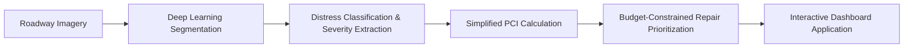

# road-pci-intelligence

An end-to-end deep learning and decision-support system designed to automate road distress detection, calculate pavement health metrics, and optimize infrastructure maintenance. Manual road pavement inspection is dangerous, subjective, and difficult to scale across municipal networks. By leveraging deep semantic segmentation to identify and quantify critical distress categories (longitudinal cracks, transverse cracks, alligator cracking, and potholes) from roadway imagery, this system computes an automated, simplified Pavement Condition Index (PCI) score and runs budget-constrained repair prioritization simulations to help municipal planners allocate road maintenance funds effectively.

---

## Planned Pipeline



1. **Data Ingestion & Preprocessing**: Sourcing, exploring, and unifying pavement distress benchmarks with pixel-level segmentation masks and multi-class annotations.
2. **Deep Semantic Segmentation**: Training deep segmentation networks (e.g., U-Net / Feature Pyramid Networks via `segmentation-models-pytorch`) to classify distress types (longitudinal, transverse, alligator cracks, potholes).
3. **Pavement Condition Index (PCI) Engine**: Measuring defect density and severity from predicted masks to formulate an objective, simplified PCI score (0–100 scale).
4. **Maintenance Optimization Simulation**: Formulating budget-constrained resource allocation algorithms (greedy heuristic & linear programming) to prioritize street repairs for maximum network condition improvement.
5. **Interactive Dashboard**: A Streamlit web application enabling users to upload inspection imagery, view segmentation overlays, inspect distress metrics, and simulate maintenance budgets.

---

## Status Checklist

- [x] **Environment & Tooling Verification** (Python 3.14, Git, Kaggle CLI, GitHub CLI authenticated)
- [x] **Project Scaffolding & Version Control** (Directory structure, requirements, git initialization, GitHub repository)
- [x] **Dataset Discovery & Selection** (Selected `pothole-image-segmentation-dataset`, `road-crack-dataset`, `crack500`, and `rdd2022es`)
- [x] **Step 1: Data Exploration & Schema Audit** *(Done)*:
  - Kaggle Notebook: [`vedshah04/road-pci-intelligence-data-exploration`](https://www.kaggle.com/code/vedshah04/road-pci-intelligence-data-exploration) ([`notebooks/01_data_exploration/`](notebooks/01_data_exploration/))
  - Directory tree audit, resolution stats, mask value distributions, duplication & base-ID leakage checks.
- [x] **Step 2: Manifests, Mask Standardization & Metric Reconciliation** *(Done)*:
  - Kaggle Notebooks:
    - Manifests & Segmentation Reconciliation: [`vedshah04/road-pci-intelligence-manifests-and-loader`](https://www.kaggle.com/code/vedshah04/road-pci-intelligence-manifests-and-loader) ([`notebooks/02_manifest_and_loader/`](notebooks/02_manifest_and_loader/))
    - Parallel RDD Manifest Builder: [`vedshah04/road-pci-intelligence-rdd-manifest-builder`](https://www.kaggle.com/code/vedshah04/road-pci-intelligence-rdd-manifest-builder) ([`notebooks/03_build_rdd_manifest/`](notebooks/03_build_rdd_manifest/))
  - Unified CSV manifests in `manifests/` with relative paths (`pothole`, `road_crack`, `crack500`, `rdd2022es`).
  - Standardized mask conversions & documented assumptions (`src/data_rules.py`).
  - Leak-proof group partitioning (pothole `pic-<N>`, road-crack scene 70/15/15, RDD2022ES mirror pairing).
  - Validation test suite (`tests/test_manifest.py`) passing 100% on Kaggle.
  - Rigorous ground-truth foreground metric reconciliation across all 1,686 masks.
  - Comprehensive documentation in [`docs/data_decisions.md`](docs/data_decisions.md).
- [x] **Step 3A: Training Pipeline, Sanity Checks & Smoke Test** *(Done)*:
  - Kaggle Notebook: [`vedshah04/road-pci-intelligence-train-baseline`](https://www.kaggle.com/code/vedshah04/road-pci-intelligence-train-baseline) ([`notebooks/04_train_baseline/`](notebooks/04_train_baseline/))
  - Pretrained U-Net (ResNet-34 ImageNet weights, `segmentation-models-pytorch`) with 2 independent sigmoid outputs `[crack, pothole]`.
  - Custom `MaskedMultiTaskLoss` (BCE + Soft Dice) with selective gradient masking for un-supervised channels (`tests/test_losses.py` passed 100%).
  - `SourceBalancedSampler` drawing 600 samples/epoch (200 crack500, 200 road_crack, 200 pothole).
  - Sanity Check 2 Overfit Test: Achieved **0.9601** Mean Dice on 8 samples (crack500: 0.9389, road_crack: 0.9509, pothole: 0.9906), well exceeding the > 0.85 target.
  - Sanity Check 3 Smoke Test: 3 full epochs completed with augmentation, AMP, and cosine decay (Epoch 3 train loss: 1.8012, mean val Dice: 0.4348).
  - Sanity Check 4: Saved 6 validation prediction overlays per source (`image | ground truth | prediction`) with clean titles.
- [x] **Step 3B: Baseline Training & Loss Mode Ablation** *(Done)*:
  - Masked Multi-Task Baseline (Run A, Seed 42, 30 epochs): [`vedshah04/road-pci-intelligence-train-masked-run-a`](https://www.kaggle.com/code/vedshah04/road-pci-intelligence-train-masked-run-a) ([`notebooks/05_train_masked/`](notebooks/05_train_masked/))
  - Naive All-Zero Negative Baseline (Run B, Seed 42, 30 epochs): [`vedshah04/road-pci-intelligence-train-naive-run-b`](https://www.kaggle.com/code/vedshah04/road-pci-intelligence-train-naive-run-b) ([`notebooks/06_train_naive/`](notebooks/06_train_naive/))
  - Comprehensive threshold sweep across $\{0.3, 0.4, 0.5, 0.6, 0.7, 0.8, 0.9\}$ ([`notebooks/07_eval_threshold_sweep/`](notebooks/07_eval_threshold_sweep/)).
- [x] **Step 3C: Cross-Domain Evaluation & Multi-Seed Benchmarking** *(Done)*:
  - Cross-Domain RDD2022ES Check (Models A & B on 2,560 validation images, threshold 0.5): [`vedshah04/road-pci-intelligence-rdd-cross-domain`](https://www.kaggle.com/code/vedshah04/road-pci-intelligence-rdd-cross-domain) ([`notebooks/08_rdd_cross_domain/`](notebooks/08_rdd_cross_domain/))
  - Multi-seed runs across seeds 42, 43, 44 ([`notebooks/09_seed_runs/`](notebooks/09_seed_runs/)).
- [x] **Step 3D: Asymmetric Partial Supervision, Exhaustive Box Statistics & Combined Evaluation** *(Done)*:
  - Exhaustive RDD box statistics across all 25,599 label files (16 threads).
  - Asymmetric loss mode implementation (`src/losses.py`) with complete unit test suite (`tests/test_losses.py`).
  - Multi-seed asymmetric training (Seeds 42, 43, 44; 30 epochs each): [`vedshah04/road-pci-intelligence-asymmetric-runs`](https://www.kaggle.com/code/vedshah04/road-pci-intelligence-asymmetric-runs) ([`notebooks/11_train_asymmetric_and_rdd_eval/`](notebooks/11_train_asymmetric_and_rdd_eval/)).
  - Combined Cross-Domain RDD2022ES Evaluation (Models A, B, C on 2,560 validation images): [`vedshah04/road-pci-intelligence-rdd-cross-domain-eval-abc`](https://www.kaggle.com/code/vedshah04/road-pci-intelligence-rdd-cross-domain-eval-abc) ([`notebooks/08_rdd_cross_domain_abc/`](notebooks/08_rdd_cross_domain_abc/)).
- [x] **Step 3E: Segmentation Model Freeze, Official Test Evaluation & Cross-Domain Audit** *(Done)*:
  - Evaluation Notebook: [`vedshah04/road-pci-intelligence-final-evaluation`](https://www.kaggle.com/code/vedshah04/road-pci-intelligence-final-evaluation) ([`notebooks/12_final_eval/`](notebooks/12_final_eval/))
  - Frozen Model: Model B (Naive Multi-Task Loss, Run B, Seed 42, Epoch 30).
  - Weights & Model Card: Private Kaggle Dataset [`vedshah04/road-pci-seg-final-weights`](https://www.kaggle.com/datasets/vedshah04/road-pci-seg-final-weights) (SHA-256: `9269c5edb6e5d37b359bd3337fbd83c60901cd2b241f9ef789e9116fee400ef7`, 24,436,514 parameters).
  - Validation TTA Sweep: Flip-TTA improved validation Dice by +0.00637 ($\ge 0.0050$ threshold) $\rightarrow$ Adopted as Official Setting.
  - Test Split Evaluation (Evaluated ONCE, N = 200 images, threshold 0.5):
    - CRACK500 ($N=72$): Dataset IoU 0.4923, Dataset Dice 0.6597, Mean Img Dice 0.6545
    - Pothole ($N=60$): Dataset IoU 0.6805, Dataset Dice 0.8099, Mean Img Dice 0.7689
    - Road Crack ($N=68$): Dataset IoU 0.4495, Dataset Dice 0.6202, Mean Img Dice 0.5319 (Non-Empty Dice 0.6213 on 55 images; 2 / 13 clean images predicted empty).
  - Out-of-Domain RDD Test Audit ($N = 2,560$ images): Clean road false flag rate 27.50% at >1% (pothole) and 0.00% (crack); deep pothole box hit rate 35.42%. Documented as out-of-domain perspective limitation.
  - Test Overlays: 8 qualitative overlays per source (including failure modes) saved in `outputs/test_eval/`.
- [ ] **Step 4: Automated PCI Computation Module** (Severity deduction curves from predicted mask areas)
- [ ] **Step 5: Budget-Constrained Optimization Engine** (Knapsack / priority repair simulations)
- [ ] **Step 6: Interactive Streamlit Web Application** (Distress overlay inspector & budget scenario planner)

---

## Project Structure

```
road-pci-intelligence/
├── app/                  # Streamlit application UI and components
├── data/                 # Raw and processed datasets (git-ignored)
├── docs/                 # Architectural documentation & data decisions
├── manifests/            # Version-controlled CSV manifests for training & validation
├── notebooks/            # Isolated Jupyter/Kaggle notebook modules:
│   ├── 01_data_exploration/     # Exploratory analysis notebook & metadata
│   ├── 02_manifest_and_loader/  # Manifest builder & reconciliation notebook & metadata
│   ├── 03_build_rdd_manifest/   # 16-worker parallel RDD manifest builder & metadata
│   ├── 04_train_baseline/       # Training pipeline, sanity checks & smoke test
│   ├── 05_train_masked/         # Run A (Masked multi-task loss baseline, 30 epochs)
│   ├── 06_train_naive/          # Run B (Naive all-zero negative loss baseline, 30 epochs)
│   ├── 07_eval_threshold_sweep/ # Validation decision threshold sweep (0.3 to 0.9)
│   ├── 08_rdd_cross_domain/     # RDD cross-domain evaluation (Models A and B)
│   ├── 08_rdd_cross_domain_abc/ # Combined RDD cross-domain evaluation (Models A, B, and C)
│   ├── 09_seed_runs/            # Multi-seed training (Seeds 42, 43, 44)
│   ├── 11_train_asymmetric_and_rdd_eval/ # Multi-seed asymmetric training & evaluation
│   └── 12_final_eval/           # Frozen model test evaluation & out-of-domain audit
├── outputs/              # Model checkpoints, evaluation plots, and reports (git-ignored)
├── src/                  # Core modular source code (rules, builders, models, PCI)
├── tests/                # Automated unit test suite (manifest validation & leak checks)
├── .gitignore            # Git ignore configuration
├── README.md             # Project overview and roadmap
└── requirements.txt      # Project Python dependencies
```
